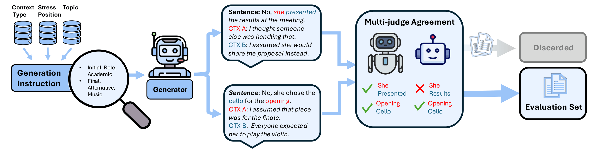

# Knowing What to Stress: A Discourse-Conditioned Text-to-Speech Benchmark

[](https://arxiv.org/abs/2604.10580)

Official code for the paper *"Knowing What to Stress: A Discourse-Conditioned Text-to-Speech Benchmark"*.

## Abstract

Spoken meaning often depends not only on what is said, but also on which word is emphasized. The same sentence can convey correction, contrast, or clarification depending on where emphasis falls. Although modern text-to-speech (TTS) systems generate expressive speech, it remains unclear whether they infer contextually appropriate stress from discourse alone. To address this gap, we present Context-Aware Stress TTS (CAST), a benchmark for evaluating context-conditioned word level stress in TTS. Items are defined as contrastive context pairs: identical sentences paired with distinct contexts requiring different stressed words. We evaluate state-of-the-art systems and find a consistent gap: text-only language models reliably recover the intended stress from context, yet TTS systems frequently fail to realize it in speech. We release the benchmark, evaluation framework, construction pipeline and a synthetic corpus to support future work on context-aware speech synthesis.


---

## Repo structure

```
CAST/
├── data/                              # Benchmark dataset (JSONL)
├── dataset_construction/
│   ├── build_eval_dataset.py          # Merge, filter, dedup  → dataset
│   ├── text/
│   │   ├── generate_pairs.py          # LLM pipeline: generate pairs + validate sentence pairs
│   │   └── prompts/                   # Jinja2 templates for generation and validation
│   └── speech/
│       └── synthesize_openai.py       # OpenAI TTS + WhiStress filtering (best-take selection)
├── cast_eval/
│   ├── run_eval.py                    # Unified evaluation CLI
│   ├── metrics.py                     
│   ├── dataset.py                     
│   └── generate/                      # Per-model TTS and text-LLM generators
│       ├── chatterbox.py
│       ├── kokoro.py
│       ├── cosyvoice.py
│       ├── higgsaudio.py
│       ├── qwen3tts.py
│       ├── openai_tts.py
│       └── text_llm.py
└── utils/
    ├── segmentation.py                
    └── text_utils.py                  
```

---

## Installation

```bash
bash install.sh
source cast_venv/bin/activate
```

This creates a `cast_venv` virtual environment, installs all Python dependencies, clones [WhiStress](https://arxiv.org/abs/2505.19103) into `third_party/WhiStress`, and downloads its model weights. WhiStress is used as the automatic stress detector for scoring generated audio. If installation fails, refer to the [WhiStress repository](https://github.com/slp-rl/WhiStress) for manual setup instructions.

TTS backends are optional — install only what you need (after activating the venv):

```bash
pip install chatterbox-tts          # Chatterbox
pip install kokoro                  # Kokoro
```

- **CosyVoice** — install from source: [github.com/FunAudioLLM/CosyVoice](https://github.com/FunAudioLLM/CosyVoice)
- **Qwen3-TTS** — install from source: [github.com/QwenLM/Qwen3-TTS](https://github.com/QwenLM/Qwen3-TTS)

---

## Evaluation

Run `cast_eval/run_eval.py` with `--model` set to one of the supported backends.

### Chatterbox

```bash
python -m cast_eval.run_eval \
    --model chatterbox \
    --dataset data/cast_benchmark.jsonl \
    --output-dir results/chatterbox \
    --mode context-concat
```

### Kokoro

```bash
python -m cast_eval.run_eval \
    --model kokoro \
    --dataset data/cast_benchmark.jsonl \
    --output-dir results/kokoro \
    --voice af_heart
```

### CosyVoice

```bash
python -m cast_eval.run_eval \
    --model cosyvoice \
    --dataset data/cast_benchmark.jsonl \
    --output-dir results/cosyvoice \
    --model-name CosyVoice-300M \
    --mode context-instruction
```

### HiggsAudio

```bash
python -m cast_eval.run_eval \
    --model higgsaudio \
    --dataset data/cast_benchmark.jsonl \
    --output-dir results/higgsaudio \
    --mode dialog
```

### Qwen3-TTS

```bash
python -m cast_eval.run_eval \
    --model qwen3tts \
    --dataset data/cast_benchmark.jsonl \
    --output-dir results/qwen3tts \
    --model-name 1.7B \
    --voice Ryan
```

### OpenAI TTS

```bash
python -m cast_eval.run_eval \
    --model openai-tts \
    --dataset data/cast_benchmark.jsonl \
    --output-dir results/openai_tts \
    --openai-voice alloy
```

### Text LLM (no audio)

```bash
python -m cast_eval.run_eval \
    --model text-llm \
    --model-name Qwen/Qwen3-0.6B \
    --dataset data/cast_benchmark.jsonl \
    --output-dir results/qwen3 \
    --n-few-shot 0
```

Results are saved to `results/<model>/metrics.json`.

### Generation modes

| Mode | Description |
|---|---|
| `context-concat` | Prepend context to sentence (default) |
| `context-instruction` | Pass context as a synthesis instruction |
| `explicit` | Pass the stressed word explicitly as an instruction |
| `tts` | No context — plain TTS baseline |
| `dialog` | Multi-turn dialog format (HiggsAudio) |

---

## Dataset construction



The benchmark pairs were generated with the following pipeline. To regenerate or extend the dataset:

### API keys

The generation and validation steps call LLM APIs. Set the environment variable corresponding to whichever models you pass to `--gen-model` and `--judge-model`:

```bash
export OPENAI_API_KEY=...       # required for gpt-* models
export ANTHROPIC_API_KEY=...    # required for claude-* models
export GOOGLE_API_KEY=...       # required for gemini-* models
```

### Step 1 — Generate and validate sentence pairs

```bash
python -m dataset_construction.text.generate_pairs generate \
    --gen-model gpt-4o-mini \
    --judge-model gpt-4o-mini \
    --gen-total 500 \
    --gen-concurrency 4 \
    --out-dir runs/
```

This writes `runs/<run_id>/gen.jsonl` (generated pairs) and `runs/<run_id>/valid_<model>.jsonl` (validated pairs).

Options:
- `--only-gen` — stop after generation, skip validation
- `--only-valid` — run validation on an existing `gen.jsonl`
- `--topics` — override default topic list
- `--ban-list FILE` — JSONL of words to exclude as stressed words

### Step 2 — Build the eval dataset

Merge one or more run outputs, deduplicate, validate pairs are intact, and write a HuggingFace dataset:

```bash
python -m dataset_construction.build_eval_dataset \
    runs/run_A/valid_gpt-4o-mini.jsonl \
    runs/run_B/valid_gpt-4o-mini.jsonl \
    --out-dir data/cast_eval_v1
```

You can also pass run directories directly — the script globs `valid_*.jsonl` automatically:

```bash
python -m dataset_construction.build_eval_dataset runs/run_A runs/run_B --out-dir data/cast_eval_v1
```

The output is a HuggingFace Arrow dataset containing all metadata fields (`sentence`, `context`, `stressed_word`` etc.) and a `file_name` column for audio lookup during evaluation.

Pass `--skip-judge-filter` to include items where the judge disagreed with the generator.

### Step 3 — Synthesize speech

```bash
python dataset_construction/speech/synthesize_openai.py \
    data/cast_eval_v1 \
    --output-dir data/synthesized/ \
    --max-tries 3 \
    --stop-when-perfect
```

Accepts a HuggingFace Arrow dataset directory (output of Step 2) or a plain JSONL file. Generates audio for each item, scores each take with WhiStress, and writes results to a `<name>.tts-whistress.jsonl` sidecar alongside the `wavs/` directory.

This is an extended version of the benchmark pipeline that adds audio synthesis, supporting broader research on context-aware stress in speech synthesis.

---

## Metrics

| Metric | Description |
|---|---|
| **Correct** | Fraction of contrastive pairs where both items are stressed correctly and contrastively |
| **Contrast** | Fraction of individual items stressed correctly and contrastively within their pair |
| **Hit** | Fraction of items where the correct word is stressed (no contrastive penalty) |

---

## Citation

```bibtex
@article{turetzky2026knowing,
  title={Knowing What to Stress: A Discourse-Conditioned Text-to-Speech Benchmark},
  author={Turetzky, Arnon and Dekel, Avihu and Aronowitz, Hagai and Hoory, Ron and Adi, Yossi},
  journal={arXiv preprint arXiv:2604.10580},
  year={2026}
}
```
